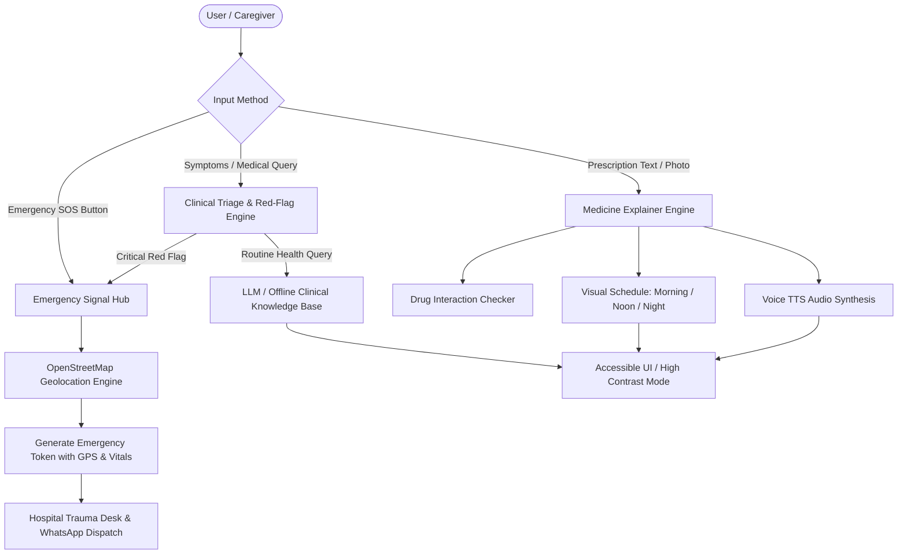

# 💊 MedPal: AI-Powered Emergency Medical Assistant & Healthcare Accessibility Platform

> An end-to-end healthcare platform combining an AI medical chatbot, real-time emergency hospital geolocation & dispatch signaling, and an accessible prescription explainer tailored for elderly and low-literacy users.

---

## 📌 Overview & Problem Statement

In acute medical emergencies, delays in locating the nearest trauma center and communicating patient vitals (allergies, pre-existing conditions, blood type) lead to preventable complications. Simultaneously, **elderly and low-literacy individuals face severe medication adherence challenges** due to complex Latin abbreviations (`1-0-1 BD pc`, `OD hs`), illegible handwriting, and confusing drug regimens.

**MedPal** solves both challenges through a single, highly accessible interface:
1. **Emergency Response Loop:** Pinpoints the closest hospital, computes driving/transit ETAs, and automatically transmits an encrypted emergency token containing the patient's vitals and GPS coordinates to the trauma reception desk.
2. **Prescription Accessibility Engine:** Converts doctor prescriptions into jargon-free 5th-grade plain language, intuitive visual routines (🌅 Morning / ☀️ Afternoon / 🌙 Night), and clear spoken audio.

---

## 🌟 Key Features

### 1. 🤖 Intelligent Medical Chatbot & Clinical Triage (MedChat)
- **Red-Flag Emergency Detection:** Instantly flags critical life-threatening conditions (e.g., Acute Coronary Syndrome / Heart Attack, FAST Stroke indicators, severe airway obstruction, massive hemorrhage) and prompts one-tap emergency hospital dispatch.
- **Dual-Engine Intelligence:** Integrates cloud LLMs (Google Gemini / Hugging Face) alongside a robust, offline-capable clinical rule engine so triage and guidance never fail during network drops.
- **Multilingual Support:** Conversational assistance in English, Hindi, Spanish, and French with natural text-to-speech voice read-out.

### 2. 🚨 Real-Time Emergency Geolocation & Hospital Signaling Hub
- **Nearest Hospital Finder:** Queries live OpenStreetMap (Nominatim & Overpass API) data to find 24/7 emergency rooms and trauma centers.
- **Interactive Routing Map:** Visualizes user location, proximity radius, nearby hospitals, and direct emergency routing using Folium / Leaflet.
- **Automated Emergency Dispatch Token:**
  - Packages patient profile (name, age, blood group, allergies, conditions, caregiver contact) and live GPS coordinates into a verified dispatch payload.
  - **4-Stage ER Lifecycle Tracker:** Simulates real-time hospital integration:
    $$\text{Signal Sent} \longrightarrow \text{ER Trauma Chief Acknowledged} \longrightarrow \text{ALS Ambulance Dispatched} \longrightarrow \text{ICU Bed Reserved}$$
  - **One-Click Hotlines & WhatsApp Alert:** Instant links to dial emergency numbers (`108`, `112`, `911`) and send pre-formatted SOS messages to caregivers.

### 3. 💊 Accessible Medicine & Prescription Explainer (Elderly Mode)
- **Zero-Jargon Explanations:** Translates medical instructions into simple, everyday language (e.g., *"Take this right after dinner to clean fats from your blood"*).
- **Universal Visual Timetable:**
  - 🌅 **Morning (Breakfast)** | ☀️ **Afternoon (Lunch)** | 🌙 **Night (Bedtime)**
  - ⏳ **Before Food (Empty Stomach)** vs 🍽️ **With Food** vs 🥗 **After Food**
  - 💧 **Water Intake Instructions** & pill visual appearance guides.
- **Voice Read-Out (Text-to-Speech):** Integrated audio playback and browser Web Speech API button for hands-free listening for illiterate or visually impaired patients.
- **Automated Drug Interaction Guard:** Scans prescription combinations in real-time to alert against high-risk drug pairs (e.g., Aspirin + Ibuprofen / Warfarin / Alcohol).
- **Daily Pill Tracker:** Interactive checklist for patients and family caregivers to log doses taken.

### 4. 🩹 Instant First-Aid Protocols
- Step-by-step visual emergency guides for **Heart Attack, Stroke (FAST), Choking (Heimlich Maneuver), Burns, Severe Bleeding, and Hypoglycemia (Low Blood Sugar)**.

---

## 🏗️ System Architecture



---

## 🛠️ Tech Stack

| Component | Technology |
| :--- | :--- |
| **Frontend UI** | Streamlit (Python), Custom CSS (High-Contrast Accessibility) |
| **Interactive Maps** | Folium, Streamlit-Folium |
| **Geolocation Data** | OpenStreetMap (Nominatim API & Overpass API) |
| **AI / LLMs** | Google Gemini (`google-generativeai`), Hugging Face Inference API |
| **Speech & Audio** | gTTS (Google Text-to-Speech), HTML5 Web Speech API |
| **Vision & Image Processing** | Pillow (PIL), PyTesseract (OCR) |
| **Language & Environment** | Python 3.10+ |

---

## 📂 Project Structure

```
medpal/
├── app.py                      # Main Streamlit web application & user interface
├── requirements.txt            # Project dependencies
├── test_medpal.py              # Automated verification & unit test suite
├── README.md                   # Complete project documentation
│
├── modules/
│   ├── __init__.py
│   ├── triage_engine.py        # Clinical triage & red-flag emergency detector
│   ├── hospital_finder.py      # Geolocation, Haversine distance, and Folium maps
│   ├── emergency_signal.py     # SOS token generation & hospital alert integration
│   ├── medicine_explainer.py   # Prescription breakdown, visual routines & drug safety
│   ├── voice_helper.py         # Text-to-speech voice synthesis (gTTS & Web Speech)
│   └── mock_data.py            # Hospital database, medicine dictionary, first-aid protocols
│
└── static/
    └── styles.css              # Custom styling for high-contrast & elderly accessibility
```

---

## ⚡ Quickstart & Installation

### 1. Clone the Repository
```bash
git clone https://github.com/your-username/medpal.git
cd medpal
```

### 2. Set Up Virtual Environment
```bash
# Windows
python -m venv venv
venv\Scripts\activate

# macOS / Linux
python3 -m venv venv
source venv/bin/activate
```

### 3. Install Dependencies
```bash
pip install -r requirements.txt
```

### 4. (Optional) Configure API Keys
MedPal includes a comprehensive offline medical triage engine, so **all core features work out-of-the-box without API keys**. If you'd like to use live cloud LLMs, add your keys in `.streamlit/secrets.toml`:
```toml
HF_API_KEY = "your-huggingface-api-key"
GEMINI_API_KEY = "your-gemini-api-key"
```

### 5. Run Verification Tests
```bash
python test_medpal.py
```

### 6. Launch MedPal
```bash
streamlit run app.py
```
Open `http://localhost:8501` in your browser.

---

## 👥 Real-World Impact & Accessibility Validation

- **Senior Citizens:** High-contrast color palette, large typography toggle, and intuitive icon-based timetables eliminate font legibility issues.
- **Low-Literacy & Vernacular Users:** Spoken audio output allows non-readers to listen to their prescription instructions in their own language without needing to decode Latin shorthand.
- **Emergency Preparedness:** Provides instant peace of mind by linking panic-stricken patients to physical emergency trauma centers with zero dead ends.

---

## 📜 Clinical Disclaimer
*MedPal is an AI-powered emergency assistance and healthcare accessibility platform. While it provides rapid triage and simplified educational breakdowns, it does not replace certified professional medical diagnosis. In life-threatening emergencies, always dial 108 / 112 / 911 immediately.*

---

## 📄 License
This project is licensed under the MIT License - see the [LICENSE](LICENSE) file for details.
